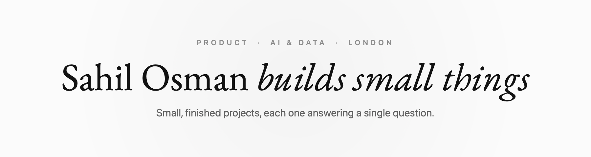
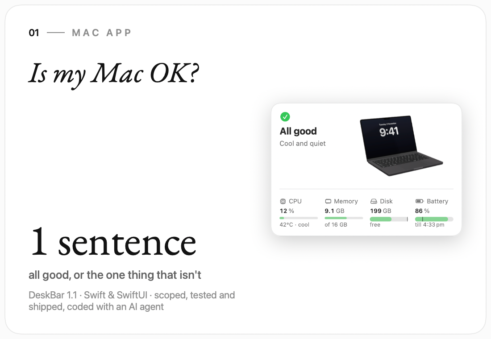
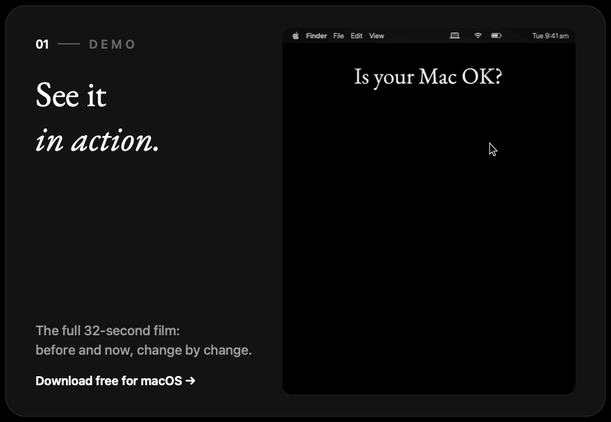
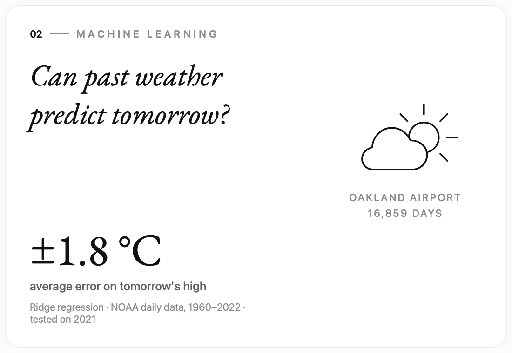
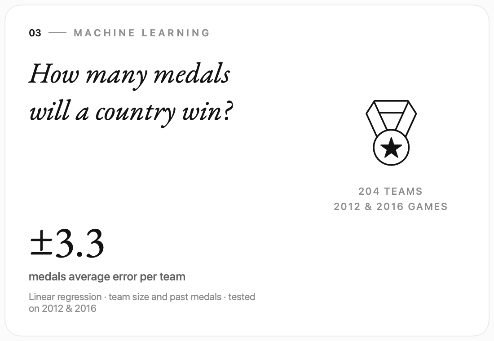

<picture>
  <source media="(prefers-color-scheme: dark)" srcset="assets/banner-dark.png">
  
</picture>

I'm Sahil, based in London. I'm curious about how products get made, from the first question to
something people actually use. So I build **small, finished projects**, each one starting with a single
question, and share what I learn along the way.

Got an idea, some feedback, or something you'd like to build together? I'd love to hear from you.

<a href="https://github.com/Osman246/DeskBar"><picture><source media="(prefers-color-scheme: dark)" srcset="assets/card-deskbar-dark.png"></picture></a>

<a href="https://github.com/Osman246/Weather_Prediction"><picture><source media="(prefers-color-scheme: dark)" srcset="assets/card-weather-dark.png"></picture></a><a href="https://github.com/Osman246/Olympic_Prediction"><picture><source media="(prefers-color-scheme: dark)" srcset="assets/card-olympics-dark.png"></picture></a>

### How I work

**Start with the question** · **decide what "done" means** · **measure, don't guess** · **cut what doesn't serve the user**

### What I use

Python · pandas · scikit-learn · Swift and SwiftUI · Agile delivery · AI-assisted development

  <a href="https://www.linkedin.com/in/sahil-osman/"><b>LinkedIn</b></a> &nbsp;·&nbsp;
  <a href="https://kaggle.com/sahilo99"><b>Kaggle</b></a> &nbsp;·&nbsp;
  <a href="https://github.com/Osman246/DeskBar/releases/latest"><b>Download DeskBar</b></a>

